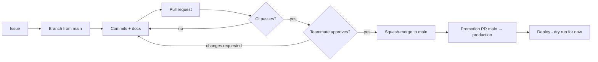

# Workflow

**In short:** log an issue, start from an up-to-date `main`, work on a named branch, update the docs, open a pull request, pass CI, get a teammate's approval, and squash-merge. Releases happen by promoting `main` to `production`.



## 1. Start clean

Before any new task, in the repository you are about to work in:

```
git switch main
git fetch --prune
git pull --ff-only
```

Then delete **local** branches whose pull requests have merged. Never delete `main`, `production`, or any `review/*` branch.

```
gh pr list --state merged --limit 200 --json headRefName --jq ".[].headRefName"
```

For each branch name in that list that still exists locally (and is not protected), run `git branch -D <branch>`. `-D` is needed because squash merges do not look merged to git. Remote branches are deleted automatically by GitHub when their PR merges.

## 2. Start from an issue

Basing work on a logged issue is strongly encouraged. Use the matching template ([issues and PRs](issues-and-prs.md)). If the work spans both application repositories, file one issue in each and link them.

Most work is already planned as slices listed in a tracker issue; the pinned **Roadmap** issue links to the tracker for the current phase ([slices and trackers](issues-and-prs.md#slices-and-tracker-issues)). Pick the next open slice whose dependencies have merged.

### Project board

One [project board](https://github.com/orgs/workforce-ops-app/projects/4) holds the issues of all four repositories, because each feature spans the backend and the frontend. Its columns are **Backlog → Ready → In progress → In review → Done**.
- New issues are added to the board automatically and start in **Backlog**. Post-merge review issues are left off (the auto-add filters exclude `-label:post-merge-review`); find them by that label in the repository's issue list.
- **The board keeps itself up to date.** Every 30 minutes the `sync-project` workflow in this repository sets each card's Status by these rules, first match wins:
  - closed: **Done**
  - an open pull request says `Closes` it: **In review**
  - a branch named `<type>/<issue#>-<slug>` exists in the issue's own repository: **In progress**
  - a person moved it to **In progress**: it stays there
  - Stretch, or blocked by an open issue: **Backlog**
  - otherwise: **Ready**, meaning anyone can pick it up. Blocking links show what an issue waits for ([issues that depend on other work](issues-and-prs.md#issues-that-depend-on-other-work)).
- **Trackers** move with their sub-issues: **In progress** once any sub-issue is closed or underway, **Backlog** before that, **Done** when closed by hand.
- **Assignees:** assign yourself when you start. When a pull request that closes an issue opens, the sync also assigns its author to the issue, so the board shows who did the work.
- **Linked pull requests:** write `Closes #N` in the pull request; that is what links it to the card. A pull request that closes no issue gets one comment from the sync, removed once a `Closes` line is added.
- **Still by hand:** the Course field on new issues, and **In progress** for a branch named after another repository's issue (the sync only matches numbers in the same repository). To update the board right away, run the workflow from the Actions tab.
- Two extra fields: **Course** (Web, Security, or Both: which course the work counts for) and **Tier** (Final demo or Stretch, matching the milestones; the sync fills a missing Tier from the milestone). Filter by Course to see what is left for the research report.
- Each tracker is a parent issue; its slices are **sub-issues**, so the card shows a progress bar. The pinned [Roadmap](https://github.com/workforce-ops-app/.github/issues/24) is the parent of the trackers.

## 3. Branch

```
git switch -c feat/14-time-off-requests
```

Format: `<type>/<issue#>-<slug>` ([naming conventions](naming-conventions.md)). One branch per topic; if you find a second, unrelated change to make, give it its own issue and branch.

## 4. Commit

Small, focused commits in the title format. The commit-message hook adds `Refs #14` from the branch name when you leave it out.

```
feat(time-off): add request model and migration

Refs #14
```

## 5. Update documentation

In the same branch, update every document the change affects ([documentation](documentation.md)). CI warns when code changes without any documentation change.

## 6. Check locally and push

```
python ../.github/scripts/ci_runner.py
git push -u origin feat/14-time-off-requests
```

## 7. Open the pull request

Use the template; fill in *Summary* and *What changed* in plain language first, then the *Details*. Mark it as a draft if it is not ready; drafts are left out of `review/integration`.

```
gh pr create --base main --fill-first   # then edit the body using the template
```

CI runs and posts one report comment that updates on every push ([CI](ci.md)).

## 8. Review and merge

- The teammate reviews and approves. New commits dismiss earlier approvals.
- All required checks must pass, and the branch must be up to date with `main`.
- Merge with **Squash and merge**. The squash commit uses the PR title and description.
- GitHub deletes the remote branch; delete your local copy at the start of your next task.

## 9. Promote to production

When `main` is ready to release, open a pull request from `main` into `production`:

- Title: `chore(release): promote main to production`
- Body: a `## Summary` listing the PRs included.
- Merge with **Create a merge commit** (never squash), so `production` and `main` share history and the next promotion only shows new changes.

There is no `staging` branch.

## Fixing something urgent

Use a normal `fix/*` branch into `main`, then promote. In a true emergency, see the bypass rules in [CI](ci.md#emergency-merges).
